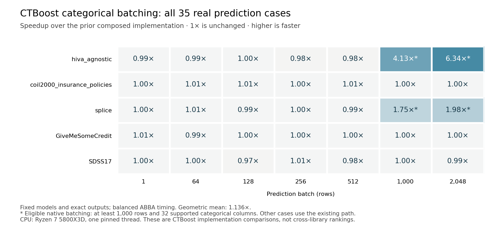
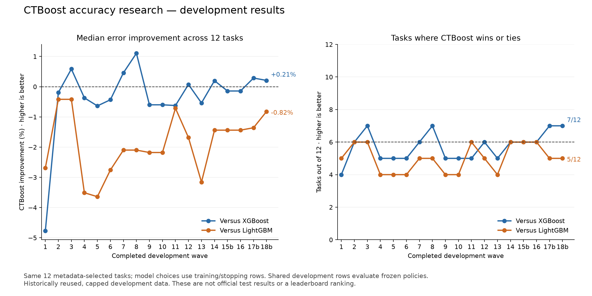

# CTBoost research and measured improvements — 16–22 October 2026

This study continues the [first experiment archive](../improvements_20261016/README.md).
The user requested actual testing against XGBoost and LightGBM while preserving
CTBoost's conditional-inference tree design. All production changes here are in
prediction preparation, categorical preprocessing, or persistence. Feature testing
still precedes cut selection; no split-selection rule has been replaced.

The inference implementation is integrated and validated. The final accuracy
experiment completed all 540 fold fits and 36 selected full-data fits. It did
not meet the declared quality target against both competitors: median relative
error reduction was +0.2075% versus XGBoost and -0.8217% versus LightGBM. The
user authorized release of validated improvements after the experiment and CI
pass, with the remaining gap documented. Accuracy-method search is closed.

A separate source audit has now confirmed float32 accumulation drift in fitted
categorical target statistics, including the saved diamonds fitting state. A
precision correction now uses double-precision mean-CTR statistics in new
version-5 pipelines, with explicit legacy-state behavior for formats 1–4.
The fix is integrated on Python 3.10 and 3.12. Both builds pass 230 native
checks, and all 12 saved CT models retain exact legacy prediction and transform
bytes. The final installed 0.1.62 CPython 3.12 candidate passed 2,526 Python
tests, with 44 optional-feature/CUDA skips. A separate pinned scientific run
passed all 447 tests with zero skips, and an isolated pandas 3.0.6 run passed
all 117 categorical-conversion checks. The main candidate environment retained
pandas 2.3.3. These overlapping test selections are not additive unique-test
counts. The [completed local-validation receipt](release_preparation/installed_candidate_02/validation_complete_20261022.json)
binds the tested package, sources, logs and results. The earlier CPython 3.10
run with eight missing-LightGBM integration failures and the complete repair
chronology remain in the [precision report](inference/ctr_precision/README.md).
No predictive-score or latency improvement is attributed to this correction.
The completed accuracy experiment retained its immutable earlier runtime.

## What is being compared

The accuracy portfolio uses 12 real cached TabArena tasks, four per problem
family, selected from metadata rather than scores. Every library receives the
same training, early-stopping, and development rows and a training-only category
vocabulary. The first five waves add eight configurations per library and
dataset; later waves test fixed-topology coefficient correction, calibration,
further training controls, and a mandatory combined TRAIN+STOP refit. Choices
use training and stopping rows, and every complete policy freezes before
development scoring.
XGBoost includes its vector-output tree option.

The development target was declared before fitting: at least six wins or ties
out of 12 and nonnegative median relative error reduction against **each**
competitor, with all fits successful. The first qualifying round triggers a
fixed-configuration second-seed check. Only a successful second-seed check
permits a one-shot official outer-test assessment. The detailed
[robustness protocol](robustness_protocol.json) was frozen before round three.

This is a bounded comparison using capped, historically reused development
data. Equal candidate counts are not equal compute or exhaustive tuning. This
study cannot establish an official TabArena ranking, universal superiority, or
a justified change to package defaults. Official outer-test labels remain
unavailable to tuning; the previous failed-gate confirmation role is also sealed.

## Measured persistence result

Compact JSON preserves the parsed model document and exact reloaded prediction
bits. On three fixed models, it is 82.65–85.88% smaller and loads 1.45–1.50x as
fast as indented JSON. The large scalar digits model falls from 449.32 MB to
63.43 MB, with median warm-cache load time falling from 3.202 to 2.129 seconds.
This does not change warm prediction speed. The existing public pickle API was
also measured separately. See the [persistence report](serialization/README.md).

## Measured inference

The final native categorical batching path preserves exact transformed features
and predictions. On the frozen real-model replication, hiva's 1,000-row raw
prediction falls from **212.05 to 51.32 ms (4.13x)** and its 2,048-row prediction
from 394.92 to 62.30 ms (6.34x), relative to the preceding composed implementation.
Splice improves 1.75x and 1.98x at those batches. Across all 35 dataset/batch
cases, the geometric speedup is 1.136x. This narrower optimization dispatches
only at 1,000 or more rows, 32 or more input columns, and supported categorical
metadata; the existing conversion handles other inputs. These gains are
specific to categorical preparation and are not universal traversal speedups.

The independently frozen replication includes 102 synthetic and 35 real cases.
Every eligible case improves in both measurement orders. No fallback repeats a
greater-than-3% regression in both orders; this does not mean every pooled
fallback ratio improves. The complete observations and eligibility boundary are
in the [final inference report](inference/final_native_codes/README.md) and
[guard replication](profile/native_guard_replication/comparison.json).

Before that last batching change, a matched-library diagnostic on all 36 wave-6
selected models measured CTBoost's raw geometric speedup as **2.27x versus
XGBoost and 2.01x versus LightGBM**, across 12 tasks and batches of 1/64/1,000.
CTBoost was faster in 36/36 and 35/36 cases respectively. Model sizes and
accuracy differ, and these are earlier selections rather than final policy
timings. The [full comparison](inference/fair_wave6/README.md) retains every task,
its error and model capacity.

On the preceding categorical-batching runtime, the separately frozen wave-11 **two-model ensembles** have
raw geometric speedups of **2.90x versus XGBoost and 2.41x versus LightGBM** over
the same 12 tasks and batches of 1/64/1,000. CTBoost is faster in 36/36 and 35/36
cases respectively. Every library performs two complete model predictions,
including fixed calibration and averaging. The only raw latency loss is churn
at 1,000 rows: CTBoost 6.680 ms versus LightGBM 5.763 ms. These ensembles failed
the accuracy gate and differ in model capacity, so this remains a serving-cost
diagnostic. It is not a paired speedup over the earlier wave-6 models. All three
measurement orders and every case are in the
[ensemble timing report](inference/fair_wave11_ensemble/README.md).

The final three-pass single-model diagnostic is complete. Across all 36
task/batch cases, raw-input CTBoost prediction was **2.247x faster than XGBoost**
and **1.915x faster than LightGBM** by geometric mean; CTBoost was faster in
36/36 and 35/36 cases respectively. These models differ in accuracy and
capacity, so this is not an equal-accuracy comparison or an official ranking.
All 36 full-development model predictions and all 108 model/batch cases matched
their saved references exactly. The separately tested installed 0.1.62 wheel
also reproduced those same records exactly. The
[complete final timing report](inference/final_execution_20261022/README.md)
contains every raw and normalized-input observation and all three passes.

The prospective
[final selection policy](inference/final_runner_preparation/selection_policy_v4.json)
selected the complete primary-seed wave-18b recovery policy after every permitted
quality stage became terminal, despite its failed accuracy gate. Only a documented
terminal numerical or resource failure before that policy is complete permits
using the whole wave-17b policy instead. The external agent interruption described
below does not authorize that fallback. Datasets, seeds and model sizes cannot
be mixed or selected by timing results. This serving-cost diagnostic does not
relax the separate accuracy gates. The policy retains the validated
CTR-precision runtime, tasks, batches and three balanced measurement orders.
Each selected model matched its saved development predictions exactly before
measurement. The historical timings above do not measure this newer runtime.

The composed categorical conversion and bin-preparation changes were measured
in a balanced six-pass sequence on five previously saved real models at batches
of 1, 64 and 1,000 rows. Relative to the first-stage implementation, raw prediction
had a 1.105x geometric speedup across these 15 cases. On hiva, the 1,000-row
median fell from 309.28 to 212.90 ms (1.453x); the one-row speedup was 1.326x.
Splice's 1,000-row speedup was 1.286x. All transformed feature and output bits
matched the reference. This is a fixed-model CTBoost implementation comparison,
not a speed comparison against XGBoost or LightGBM.

The revised single-row dispatch uses already fitted metadata to avoid checking
all DataFrame dtypes for numeric or mixed inputs. Its fast path accepts only
small exact-string categorical vocabularies and otherwise retains the existing
conversion. This removed the numeric-input regressions found in the first
prototype. Details and all original observations are in the
[inference report](inference/README.md) and [profile report](profile/README.md).

## Final accuracy result

The complete wave-18b recovery policy is the final result. All 540 shared-fold
fits and 36 mandatory combined-data fits passed. CTBoost achieved **+0.2075%
median relative error reduction versus XGBoost, with 7/12 wins**, and
**-0.8217% versus LightGBM, with 5/12 wins**, with no ties. The combined primary
gate failed, so seed 677 and the official test were not run. Confirmation data
remained sealed. Cumulative completed native model fits total **3,107**, including
the interrupted native fit; eight earlier diagnostic replays are separate.
Copied verified results are not counted as new fits. The
[final summary](accuracy_wave18b_recovery/summary.json),
[independent completion audit](validation/wave18b_continuation_20261022/primary_policy_audit.json),
and [accuracy report](accuracy.md) record all task errors, selection controls,
resources and limitations. This adaptive development study does not establish
an official ranking or universal advantage. No learning default changed.

Wave 17b was the preceding complete policy. All 48 new certified regression solves,
96 adjusted candidate checks and 24 fresh combined-data fits passed. It reused
the 12 complete binary searches and carried the 12 multiclass models unchanged.
Fifteen of the 24 scalar models select a nonzero correction. CTBoost's median
relative error gain is **+0.286% versus XGBoost, with 7/12 wins**, but
**-1.359% versus LightGBM, with 5/12 wins**. The combined target is still unmet;
seed 569 and the official test were not opened. Through this round, the study
has completed **2,472 benchmark model fits (824 per library)**, plus eight
separate diagnostic training replays. The
[complete retry summary](accuracy_wave17b/summary.json) retains every task,
numerical certificate, selection and resource result.

Wave 17 stopped at its numerical-success barrier. Its LightGBM diamonds ridge
solve at lambda 1 reached the fixed 2,000-iteration LSQR limit; the two shrinkage
candidates that depend on that solve failed. The failure is preserved. No final
combined-data refits, development scoring, second-seed check or official-test
assessment followed from that attempt. A separate training-only numerical
diagnostic tested preconditioning
without changing the ridge objective. Its objective, adjoint, convergence
certificate and edge cases passed 43 synthetic checks before the real run.
All three solver variants then failed the frozen 2,000-iteration acceptance
checks; column scaling did not repair convergence. The
[frozen plan](ridge_numerical_diagnostic/plan.json) and numerical receipts
retain those failures. A separately frozen unscaled LSQR diagnostic with
stricter tolerances and a 10,000-iteration cap then converged in 5,541 iterations.
Its original-objective relative dual gap is 1.83e-14 and normalized gradient
2.18e-9, both within the unchanged acceptance limits. See the
[certified numerical result](ridge_numerical_diagnostic_extended/numerics/unscaled_lsqr_10000.json).
This establishes a numerical repair. The complete scalar-refresh retry used the separately frozen
[wave-17b protocol](accuracy_wave17b/plan.json). It reuses 24 verified clean
anchors and the 12 complete binary grids, repeats all 48 regression solves with
the certified settings, and requires 24 fresh combined-data refits before
development scoring. All 21 synthetic integration checks passed before launch.

A [full-current-data tree-count CV runner](full_current_cv_preparation/README.md)
was independently reviewed, with 46 support, 30 native, and 52 executable checks
passing. Wave 18 stopped for insufficient system headroom after 58 successful
fold fits. No worker exceeded its memory limit and no numerical check failed;
the next worker never started because all 61 samples over 300 seconds remained
below the reserved 14 GiB floor. No policy selection, combined-data refit or
development score followed. This takes the completed benchmark model-fit count
to **2,530**, plus eight separate diagnostic replays.

[Wave 18b's frozen plan](accuracy_wave18b/plan.json) follows the
[prospective resource amendment](validation/wave18b_resource_amendment.json),
which tightens the process cap from 10 to 8 GiB while retaining the 4 GiB host reserve,
6 GiB named-array cap, solver settings, time limits and every scientific choice.
The available-memory admission floor is consequently 12 GiB. It repeats all
fits afresh, preserving the failed attempt. The independent preparation audit
verifies identical folds and inherited controls. Its procedure uses
540 shared-fold fits and 36 fresh combined-data fits, keeping the current
correction controls fixed. Preparation and synthetic checks add no real
benchmark model fits to the counts below.

An agent mistakenly stopped the owned worker for global fold job 297 after its
native fit returned. The original attempt retains 297 fully verified jobs,
298 completed native fits and 242 unstarted jobs; it has no selected policy,
union refit or development score. This is an external intervention, not an
XGBoost, numerical or resource failure. The [incident report](release_preparation/wave18b_external_interruption_incident.json)
records the action, and the [independent audit](validation/wave18b_terminal_independent_audit.json)
verifies the preserved evidence. Cumulative benchmark fits at interruption are
2,828, with eight earlier diagnostic replays counted separately.

The [recovery plan](accuracy_wave18b_recovery/recovery_plan.json) preserved the
scientific plan and all worker/input/runtime bytes. It copied the 297 verified
prefix jobs exactly and dispatched original indices 297–539 afresh under the
same limits. All 540 verified folds and 36 fresh union fits completed before
development scoring. The incident-specific controller passed 29
synthetic tests and an independent metadata review before execution; its
[validation records](validation/wave18b_external_recovery/validation.json)
are separate from benchmark fits. The interrupted native fit is counted once
as extra compute; reused jobs are not counted as newly trained models.

All 24 fresh anchors succeeded. Of 96 attempted correction solves, one failed;
190 of 192 adjusted candidates and all 24 identities passed. No watchdog limit
was reached. Through this stopped attempt, the study had completed **2,448
benchmark model fits (816 per library)**, plus eight separately counted
diagnostic training replays. The [terminal summary](accuracy_wave17/summary.json)
records the actual work and closed gates.

Wave 17 refreshes binary and regression correction choices on current tree
counts and expanded training sources, starting from clean models with old
corrections disabled. It passed 11 integration checks plus 30 clean-refit
verifier checks before fitting. The
[wave-17 plan](accuracy_wave17/plan.json) and
[policy](robustness_protocol_scalar_refresh.json) retain the exact controls.

Through wave 16, the study has completed **2,424 benchmark model fits**, plus
separately counted leaf-correction and calibration evaluations and eight
diagnostic training replays. That experiment jointly adjusts existing
multiclass leaf values while preserving topology, class assignments and fixed
temperature. All 12 fresh TRAIN anchors, 48 optimization solves, 96 adjusted
candidates, 12 identity evaluations and 12 final transfer jobs passed. Eight
models selected a correction, including all four CTBoost models. The other
24 binary/regression models carry unchanged.

CTBoost's website-phishing log loss improves from 0.15725 to 0.14586 and SDSS17
from 0.09115 to 0.08798. Anneal and splice worsen slightly. There are no extra
task wins, so the full-panel medians remain **-0.143% versus XGBoost** and
**-1.439% versus LightGBM**, with **6/12 wins against each**. Seed 457 and the
official test remain closed. No wave has met both thresholds, and no default
training option changed.

Wave 15b adds 3,760 previously unused
houses training rows, taking its fitting set to 11,260. All three libraries
receive the same rows and retain their parameters, corrections and requested
tree counts. All three new fits passed; the other 33 models carry unchanged.
CTBoost's houses RMSE improves from 0.22243 to 0.21717, but the full portfolio
still misses the target: **-0.143% median relative error gain versus XGBoost**
and **-1.439% versus LightGBM**, with **6/12 wins against each**. Seed 349 and
the official test were not opened.

The houses source has a verified original checksum. A byte parser decodes only
the 11,260 authorized rows; all original TRAIN/STOP values match exactly, and
9,380 excluded rows remain undecoded. The first attempt stopped at an unsupported
header alias before fitting. The separately frozen retry adds the documented
`REAL` numeric alias. A subsequent report-only recovery preserves and exactly
matches all 36 original prediction archives; no model or selection changed.

Wave 14 expanded fitting rows from 7,500 to 97,500 on Credit, 33,460 on diamonds
and 49,535 on SDSS17. All nine new fits passed, with 27 models carried unchanged.
It met the XGBoost threshold (+0.198%, 6/12 wins), but missed LightGBM (-1.439%,
6/12). Its unused seed 239 check remains closed. These expanded training sources
are retained in the current policy.

The preceding wave 13 chose model length using five
shared folds, with fold-local preprocessing and fixed inherited controls. All
540 fold fits and 36 mandatory union refits passed. Of the 36 choices, 8 use half
the previous requested rounds, 18 retain the count and 10 double it. Median
relative error gains were -0.539% against XGBoost (5/12 wins) and
-3.158% against LightGBM (4/12). Negative gains mean CTBoost's errors were
higher. This policy failed the gate; seed 137 was not opened.

The preceding wave 12 tested less restrictive split eligibility and smaller
learning rates. It met the XGBoost threshold (+0.073%, 6/12 wins), but missed
LightGBM (-1.685%, 5/12). The later CV result is retained as a failed experiment;
there is no development-based fallback to the earlier policy.

The [accuracy report](accuracy.md) includes every task and unsuccessful wave.
Binary logistic leaf correction completed all 96 candidate evaluations and
mandatory union transfers, but missed the quality gate. Fixed two-seed averaging
for every library also missed the gate in wave 11. The separate
[root-stopping audit](root_stopping_replay/README.md) reproduced eight frozen
models exactly and identified statistical rejection at 580 of 1,061 roots.
That finding motivated wave 12; its outcome does not establish a generally
better significance threshold. The data-cap and multiclass-correction
experiments have not met the combined target. The completed scalar-refresh
retry uses current tree counts and larger training sources and passes every
numerical check, but still misses the LightGBM quality threshold. The next
experiment tests tree counts using shared folds over all authorized fitting rows.
All three libraries receive the same candidate grid. Existing development and
confirmation rows stay excluded from fitting. The official outer test and
original failed-gate confirmation role remain sealed.

## Integrated implementation validation

The preceding categorical-batching runtime's full Python 3.10 run passed
**2,192 tests**, with 46 optional skips and no
failures. Python 3.12 passed 198 focused interoperability tests, and both native
builds passed all 230 CTest checks. All 35 real-model transform/prediction cases
and all 36 wave-9 selected-model outputs reproduce their frozen references
exactly. The final binary-correction helper separately passes all 14 scientific
and native-fold checks under Python 3.12 with all three libraries installed.
Subsequent experiment-runner tests are recorded separately in their protocols
and review receipts. Build identities, logs and source receipts are linked from the
[integration evidence](inference/final_native_codes/README.md).

The subsequent CTR-precision runtime has its own
[validation receipt](inference/ctr_precision/validation.json), including the
original full-run failures, targeted repairs, explicit skips, exact old-model
compatibility checks and both new native build identities. The two validation
generations are retained separately.
The historical [CPython 3.10 full-sequence receipt](inference/ctr_precision/final_full_cp310/classification.json)
records 2,552 passes, eight missing-LightGBM research-test failures and 125 skips,
alongside exact-source coverage for those research tests in the accuracy runtime.
The later [installed 0.1.62 candidate validation](release_preparation/installed_candidate_02/validation_complete_20261022.json)
passed the full CPython 3.12 suite, the required scientific selection, the pandas
3 compatibility checks, and all native checks, as detailed above.

The categorical-batching packaging audit added the new helper to the explicit source
distribution allowlist. A backend-built sdist contains it exactly once, with
bytes matching the tested source. This packaging-only correction followed the
runtime tests above; the [archive membership receipt](inference/packaging/sdist_membership.json)
records the built artifact and source hashes.
A newer [source-package check](inference/ctr_precision/sdist-membership.json)
covers the CTR-precision changes and test-isolation fixture as well.

## Research and rejected experiments

The [research note](research.md) connects primary sources to practical
experiments, and the [review log](review.md) records protocol and correctness
checks. OpenAI's recent integer- and matrix-multiplication results are discussed
in the [first research archive](../improvements_20261016/research.md). Their
asymptotic advances do not by themselves provide a useful crossover for this
branch-heavy tree evaluator. The tested dense-matrix routing prototype was
slower and was not retained.

An [additional compression review](compression_research_followup.md) distinguishes
fixed-topology leaf optimization from pruning methods and their different
equivalence guarantees. None of those compression methods has been applied or
claimed as a measured CTBoost improvement.

This follow-up also rejected a 24-byte inference node layout after mirrored
timings showed slower native traversal. A first Python single-row categorical
shortcut helped categorical inputs but regressed mixed and numeric inputs;
those measurements are preserved, and only the revised dispatch was retained
after a separate composed timing run. No unfavorable observation is removed
from the archive.

## Reproduction and evidence

Each experiment saves the exact runner, package/native identities, model/input
hashes, parameters, individual observations and selection decisions. Large
local datasets and model binaries remain in the ignored `.tmp` workspace;
their paths and hashes are recorded. This evidence archive is excluded from
published wheels. The original first-stage archive is preserved independently.

The public follow-up archive includes validation logs, the small synthetic CTR
compatibility model and numerical coefficient arrays. The 418 STOP prediction
NPZ archives remain local because they also contain benchmark labels and row
IDs. Their exact paths, sizes and hashes are retained in the final manifest's
`local_only_artifacts`; `files` lists only the public artifacts. Nested frozen
receipts are unchanged, so their NPZ references identify local evidence rather
than downloadable files. Python cache files are excluded. The first-stage
archive keeps its established local-only exclusions for the synthetic tensor
model/input and the original build log. The approved ignored-file copy/staging
list is recorded in
[public_ignored_evidence.json](release_preparation/public_ignored_evidence.json).

The final manifest lists public evidence and source snapshots separately from
local-only prediction artifacts. Release packaging and local validation receipts
under `release_preparation/` distinguish the final 0.1.62 candidate from the
immutable scientific and timing runtimes used by this study.
